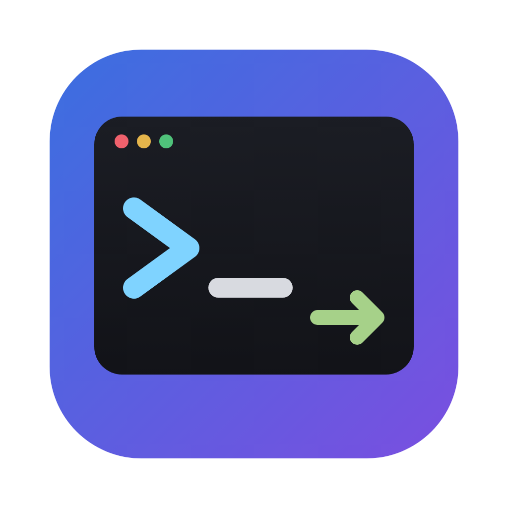

# SSHub

[English](README.md) | **简体中文**

SSHub 是一款 macOS 上的 SSH 远程连接 + SFTP / FTP 文件传输工具，相当于把 Xshell 和 Xftp 合在一个应用里。

**官网：https://flight123-cloud.github.io/SSHub/zh/**

<p align="center"></p>

## 功能

- **会话管理（左侧列表）**：保存服务器（协议、名称、分组、主机、端口、用户名、密码），下次**双击**、点「连接」按钮或选中后按 **Enter** 即可连接；支持搜索、分组折叠、复制、编辑、删除
- **两种协议**
  - **SSH / SFTP**：终端 + 文件传输；登录方式支持密码、私钥（含带口令的私钥）、SSH Agent / 默认密钥
  - **FTP / FTPS**：文件传输；支持明文 FTP、显式 FTPS（FTP over TLS）、隐式 FTPS、匿名登录，自签名证书可选择跳过校验
- **快速连接**：在侧边栏输入地址回车即可连接，勾选「保存到左侧会话列表」就能存下来
  - `root@1.2.3.4`、`user@host:2222`：SSH
  - `ftp://user@host`、`ftp://host`（匿名）：FTP
  - `ftps://user@host`：显式 FTPS；`ftps-implicit://user@host`：隐式 FTPS
- **多标签终端**：基于 xterm.js，支持 256 色、中文、查找（⌘F）、清屏（⌘L）、字体缩放（⌘+ / ⌘-）、链接点击
  - **GPU 加速渲染**（WebGL），大量输出（`tail -f`、`top`）时更流畅；不支持时自动退回普通渲染
  - **粘贴保护**：粘贴多行内容前弹窗确认，可「去掉末尾换行后粘贴」，防止误执行；远程程序已开启括号粘贴模式（新版 bash、vim）时不打扰
  - **服务器复制到本机剪贴板**（OSC 52）：在服务器上的 vim / tmux 里复制，内容直接到 Mac 剪贴板；服务器读取本机剪贴板始终被禁止
  - **选中即复制**、右键直接粘贴（可选，类似 PuTTY / Xshell）
  - 调整窗口大小时在终端中央显示「列 × 行」
  - **最低对比度**：自动调亮看不清的文字颜色
  - **Option 键作为 Alt**：在 bash / emacs 中使用 Alt 快捷键
  - 一键**将终端输出保存为文件**（⌘⇧S）
- **终端分屏**：一个标签页里左右（⌘D）/ 上下（⌘⇧D）拆分多个终端，每个分屏是独立的 SSH 连接
  - 拖动分隔条调整大小，⌘⌥方向键在分屏间切换，⌘⇧Enter 放大 / 还原当前分屏，⌘W 关闭当前分屏
  - 未聚焦的分屏自动变暗，一眼看出正在输入的是哪一个
- **主题配色**：界面支持深色 / 浅色 / 跟随系统；内置 14 套终端配色（One Dark、Dracula、Solarized、Gruvbox、Nord、Tokyo Night、Monokai、Catppuccin 等），深色和浅色模式可以分别选择
- **Quick Terminal**：在任何应用里按全局快捷键（在设置里开启并自定义，默认 ⌃\`），终端从屏幕顶部滑出，自动连接你指定的服务器；再按一次收起，连接保持，下次呼出立即可用
- **半透明 / 毛玻璃背景**：终端背景不透明度可调（30%–100%），可开启 macOS 原生毛玻璃效果
- **终端内显示图片**：支持 Sixel 和 iTerm2 图片协议（`img2sixel`、`imgcat` 等工具）
- **连字字体**：使用 Fira Code、JetBrains Mono 等字体时，`=>`、`!=`、`->` 等显示为连字（设置中开启）
- **撤销关闭标签页**：关闭后 10 秒内按 ⌘Z 或 ⌘⇧T（或点提示里的「撤销」）恢复，连接不会断开
- **提醒**
  - **长命令完成通知**：命令运行超过设定时间（默认 10 秒）后结束，如果窗口或标签页不在前台，就发送 macOS 通知并让 Dock 图标弹跳；点击通知直接跳到对应标签页
  - 通过识别命令提示符判断命令结束；服务器配置了 shell 集成（OSC 133）时还能显示退出码
  - 服务器程序可以用 `printf '\e]9;消息\a'`（OSC 9）或 OSC 777 主动发通知，例如在构建脚本末尾提醒自己
  - 后台标签页响铃或有提醒时，标签页上会显示标记
- **命令面板**：⌘P 搜索会话 / 标签页并连接、切换；⌘⇧P 搜索并执行任何操作（支持模糊匹配，如输入 `pdb` 匹配 `prod-db`）
- **设置**（⌘,）：字体、字号、行高、光标样式、回滚行数、GPU 渲染、粘贴保护、剪贴板、右键行为、双击文件行为等，修改立即生效
- **双栏文件管理（SFTP / FTP 通用）**：左边本地、右边远程
  - 双击文件或用 → / ← 按钮传输，也可以在两栏之间拖拽，或直接从 Finder 拖文件到远程栏上传
  - 支持整个文件夹上传和下载，显示进度和速度，传输可以取消
  - 远程文件可以新建文件 / 文件夹、重命名、删除、创建副本、移动到其他目录（也可以拖到文件夹上移动）、修改权限（chmod）
  - FTP 连接被服务器空闲断开后，下次操作会自动重连
  - 部分 FTP 服务器不支持修改权限（SITE CHMOD），这时会提示失败
- **在线编辑服务器文件**
  - **双击文本文件**（配置文件、脚本、代码、日志等）直接用内置编辑器打开，修改后 ⌘S 保存回服务器
  - 内置编辑器支持语法高亮（上百种语言和配置格式）、行号、查找替换（⌘F，支持正则）、跳转到行（⌘G）、自动换行、括号匹配、代码折叠
  - 自动识别文件编码（UTF-8 / GBK / Big5），保存时保持原编码、原换行符（LF / CRLF）和 BOM，也可以在底部状态栏手动切换
  - 任意文件都可以右键「**用本地应用打开**」：用 Mac 上的默认应用（如 VS Code、Word、预览）打开，**保存后自动上传回服务器**
- **编码设置**：会话里可以选 UTF-8 / GBK / Big5
  - 终端：服务器使用 GBK 时，中文输出和输入都会正确转换
  - FTP：Windows 或较老的 FTP 服务器上的 GBK 中文文件名能正确显示、上传、下载和改名
  - SFTP 文件名始终按 UTF-8 处理（底层库的限制）
- **终端+文件模式**：终端和文件管理上下同时显示（⌘3）
- **安全**
  - 密码和口令用 macOS 钥匙串加密后保存在本机
  - 首次连接会确认服务器指纹，指纹变化时会发出警告（防止中间人攻击）
- **断线重连**：连接断开后，在终端里按 Enter 就能重新连接

## 怎么找到这些功能

- **新功能导览**：升级后第一次打开会自动显示；之后可以点标题栏右上角的 ✦ 按钮，或菜单栏「帮助 → 新功能介绍」再次查看。每项功能都有「试一试」按钮
- **标题栏右上角**：「搜索或执行命令」（命令面板）、✦ 新功能、? 快捷键一览、⚙ 设置
- **终端上方工具栏**：向右拆分、向下拆分、放大分屏、查找、更多操作（清屏、保存输出、均分分屏等）
- **欢迎页**：没有打开任何连接时，显示常用入口
- **快捷键一览**：⌘/

## 下载安装

1. 打开本仓库的 [Releases](../../releases) 页面（或 [Actions](../../actions) 里最新一次成功构建的 Artifacts），下载安装包：
   - **Apple 芯片（M1/M2/M3/M4…）**：`SSHub-x.y.z-mac-arm64.dmg`
   - **Intel 芯片**：`SSHub-x.y.z-mac-x64.dmg`

   不知道是哪种芯片？点屏幕左上角  →「关于本机」，看「芯片」或「处理器」那一项。
2. 双击 dmg，把 SSHub 拖进「应用程序」文件夹。
3. **第一次打开**：这个应用没有经过 Apple 公证，macOS 会提示「Apple 无法验证"SSHub"是否包含恶意软件」。可以用下面任一方法解决：
   - 先点「完成」关掉提示，然后打开「系统设置 → 隐私与安全性」，拉到最下面，在"已阻止 SSHub"旁边点「仍要打开」，再确认一次；
   - macOS 14 及更早版本也可以在「应用程序」里**右键点 SSHub →「打开」→ 再点「打开」**；
   - 如果提示「已损坏，无法打开」，在「终端」里执行下面这条命令，然后再打开：

     ```bash
     xattr -cr /Applications/SSHub.app
     ```

## 快捷键

| 快捷键 | 功能 |
|---|---|
| ⌘N | 新建会话 |
| ⌘P | 搜索会话 / 标签页 |
| ⌘⇧P | 命令面板 |
| ⌘, | 设置 |
| ⌘K | 快速连接 |
| ⌘W | 关闭当前分屏（只有一个时关闭标签页） |
| ⌘⇧[ / ⌘⇧] | 切换上一个 / 下一个标签 |
| ⌘1 / ⌘2 / ⌘3 | 切换到 终端 / 文件传输 / 终端+文件 |
| ⌘B | 显示 / 隐藏会话列表 |
| ⌘F | 在终端中查找 |
| ⌘L | 清屏 |
| ⌘D / ⌘⇧D | 向右 / 向下拆分终端 |
| ⌘⌥←→↑↓ | 在分屏间切换 |
| ⌘⇧Enter | 放大 / 还原当前分屏 |
| ⌘Z / ⌘⇧T | 撤销关闭标签页 |
| ⌘⇧S | 将终端输出保存为文件 |
| ⌘+ / ⌘- / ⌘0 | 放大 / 缩小 / 重置字体 |
| ⌘S | 在线编辑文件时保存 |
| ⌘F / ⌘G | 编辑器里查找替换 / 跳转到行 |

## 数据存放位置

- 会话：`~/Library/Application Support/SSHub/sessions.json`（密码是加密后保存的）
- 已信任的 SSH 主机指纹：`~/Library/Application Support/SSHub/known_hosts.json`
- 设置：`~/Library/Application Support/SSHub/settings.json`

## 开发

技术栈：Electron + React + TypeScript；SSH/SFTP 用 [ssh2](https://github.com/mscdex/ssh2)，FTP/FTPS 用 [basic-ftp](https://github.com/patrickjuchli/basic-ftp)，终端用 [xterm.js](https://xtermjs.org/)，打包用 electron-builder。

```bash
npm install
npm run dev        # 开发模式运行
npm run typecheck  # 类型检查
npm run dist:mac   # 打包 macOS dmg（需要在 Mac 上执行）
```

每次推送代码后，GitHub Actions 会自动在 macOS 上构建 dmg。推送 `v*` 格式的标签（例如 `v0.1.0`）时，还会自动发布 Release。

```
site/         官网（GitHub Pages，推送到 main 后自动部署）
  index.html    英文版（默认）
  zh/           中文版
src/
  main/       主进程
    ssh.ts          SSH 连接与终端
    ftp.ts          FTP / FTPS 连接
    sftpfs.ts       SFTP 文件操作
    ftpfs.ts        FTP 文件操作
    connections.ts  连接管理与传输队列（两种协议共用）
    store.ts        会话存储（密码加密）
  preload/    安全桥接（contextBridge）
  renderer/   界面（React）
  shared/     共享类型
```

## 许可证

[Apache-2.0](LICENSE)
